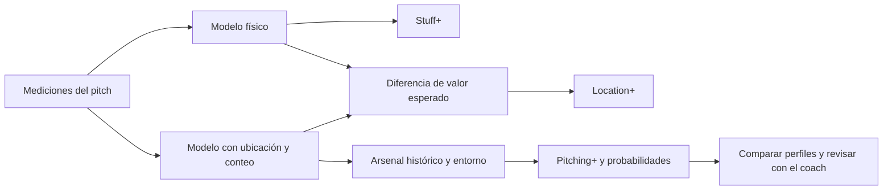
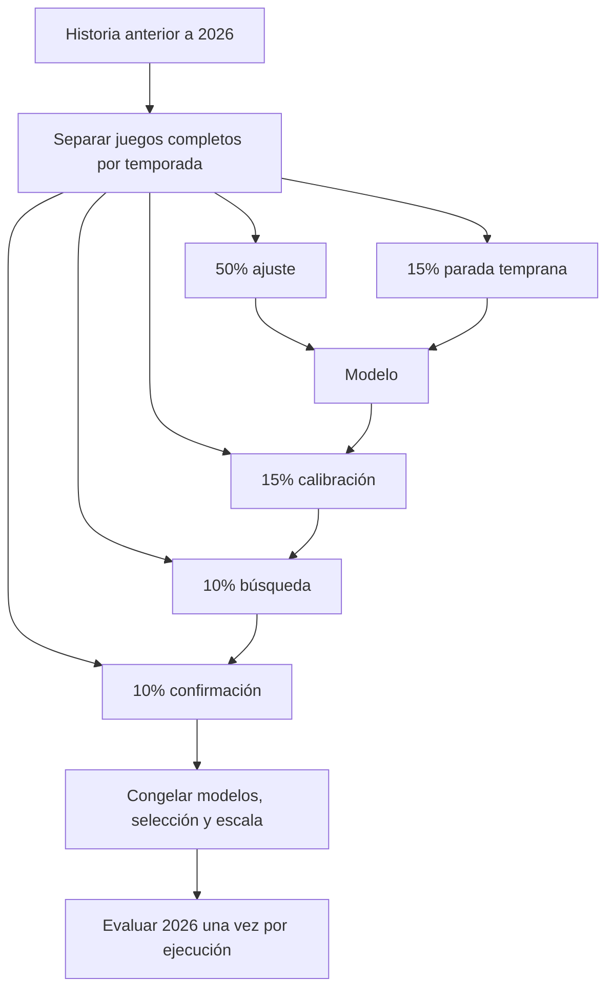

# Stuff+ Diablos: guía del reto, del modelo y de su uso

**Entrega actual completada:** [documento de nueve páginas](../../reports/v9_estadios/DOCUMENTO_TECNICO_ESTADIOS.pdf) y [metodología del complemento](../../reports/v9_estadios/complemento/METODOLOGIA.md). Incluye probabilidad de out al cerrar el turno, índice integral de ocho objetivos y comparación histórica normalizada por temporada/estadio. Las tres validaciones del objetivo PA terminaron; 32 pruebas pasaron desde el paquete en un entorno Python limpio. Las descripciones de carencias de v9 original que siguen abajo son históricas.

**Actualización del 27 de octubre:** ya existe un mapeo auditado juego–estadio.
El [reentrenamiento por estadios](REENTRENAMIENTO_ESTADIOS.md) incorpora `stadium_id`
en el contexto y permite comparar Harp Helú en el simulador. Las limitaciones de
identificación descritas en las secciones históricas de esta guía corresponden al
dataset anterior; consulta `clasificacion_estadios/README.md` para cobertura y criterios.

**Actualización del 22 de octubre:** [PROJECT_APPROACH.md](PROJECT_APPROACH.md) documenta una mejora opcional `--incremental-gate`: arsenal compite contra ubicación y entorno contra la capa anterior, con herencia de predicciones si no se confirma una ganancia. La ejecución original y sus resultados descritos abajo se conservan. El [PDF técnico](../../reports/v9/DOCUMENTO_TECNICO_V9.pdf) ya está generado con ocho páginas.

Esta guía conecta la convocatoria **2026 ISAC Hackathon – Diablos Rojos** guardada en el HTML del repositorio con el código, los datos, la validación y la decisión deportiva. La entrega v8 conserva sus resultados históricos. **v9 es un experimento independiente**, con modelos entrenados desde el parquet y una separación más estricta de las capas del reto. Sus resultados reales se generan en `stuff_plus_output_v9/RESULTADOS.md`; los informes compartibles se guardan en `reports/v9/`.

## 1. Entenderlo en dos minutos

Un lanzamiento tiene al menos tres preguntas distintas. **Stuff+** pregunta qué calidad esperamos por sus características físicas. **Location+** pregunta cuánto cambia el valor esperado al conocer su ubicación, conteo y lado del bateador. **Pitching+** incorpora además su relación con el arsenal y el entorno.

Piensa en una recta de 94 mph con buen movimiento: puede recibir un buen Stuff+ y terminar mal ubicada. La calidad física y la calidad contextual pueden apuntar en direcciones distintas. El sistema permite examinar esa diferencia; un resultado observado aislado no define por sí solo la calidad del lanzamiento.



La escala es `100 + 10 × z`. **110 equivale a una desviación estándar por encima de la referencia; no equivale a 10% más outs.** Tampoco garantiza un percentil exacto: eso dependería de la distribución. Los tres índices tienen referencias distintas y no se suman entre sí.

## 2. Qué exige la convocatoria

Fuente primaria: [HTML local](../../2026%20ISAC%20Hackathon%20-%20Diablos%20Rojos_%20Stuff%20Plus%20Model,%20Calidad%20de%20Pitcheo%20Ajustada%20por%20Entorno.html). Se usó su contenido completo, incluyendo restricciones y entregables.

| Criterio | Peso | Evidencia necesaria | Implementación y límite |
|---|---:|---|---|
| Calidad del modelo | 25% | RMSE, calibración y comparación contra promedio por conteo | Modelos residuales de carreras, probabilidades calibradas y baselines explícitos |
| Robustez | 25% | Pitcher, season y park holdout | Modos separados por temporada, pitcher y entorno; park requiere una columna `stadium` validada |
| Arsenal y altitud | 25% | Variables relacionales y delta por perfil | Historia anterior, cuatro capas y comparaciones pareadas; buckets no identifican parques |
| Uso deportivo | 25% | Scores, perfil ideal, recomendaciones, simulador, mapa y explicación | Dashboard guiado, scores y agregados, referencias históricas v8 e informe del experimento v9 |

Los cinco entregables obligatorios son: scores por pitch/pitcher/arsenal; perfil físico ideal para Diablos; recomendaciones operativas; simulador con comparación de entornos y mapa de movimiento; documento técnico de **6–10 páginas**. La entrevista final dura 10 minutos.

El HTML fija entrega de proyectos el **22 de octubre de 2026**, anuncio de finalistas el 2 de noviembre, final el 11 de noviembre y anuncio de ganadores el 12 de noviembre. Indica equipos de **2–4 estudiantes** de licenciatura o maestría, con evidencia de inscripción para ganadores. La entrega es por correo a `itamsportsanalytics@gmail.com`, incluyendo correos de todos los integrantes. Estas fechas corresponden al archivo local; no se presume una actualización posterior.

Los datos son para la competencia. Se permite presentar resultados, pero no publicar los datos originales. Los participantes conservan la propiedad intelectual del proyecto, no la de los datos. Se excluye el uso para apuestas. La fase finalista contempla NDA. Este trabajo no envía correos ni publica información.

## 3. Qué datos tenemos y qué falta

`Data/stuff_model_df.parquet` es el origen local completo. Su SHA-256 coincide con el puntero del repositorio: `52d439289aa66f7e235bc60982bd7a2ea728e0ab533b7c10eb8e837e47f1415b`. El cargador v9 lo busca antes del parquet de la raíz. Los archivos `.parquet` y `.cbm` pequeños que comienzan con `version https://git-lfs...` son referencias de Git LFS, no datos ni modelos utilizables.

El diccionario describe física, ubicación, categorías de altitud, año, IDs anónimos y resultados. `PitchUID` sirve para unir predicciones; los IDs de juegos y pitchers sirven para separar muestras y agregar resultados. **Ningún ID entra como predictor.** El año se usa para dividir historia y evaluación.

La lectura local confirmó 243,254 pitches y 833 juegos en 2024; 256,144 pitches y 839 juegos en 2025; y 135,604 pitches y 455 juegos en 2026. Faltan IDs de pitcher en 150 filas de desarrollo y 3,122 de evaluación. Se conservan para la evaluación temporal con arsenal ausente; se excluyen de la auditoría por pitcher. En auditorías por entorno se excluyen del desarrollo las filas cuya categoría es desconocida, para no asignarles un grupo inventado.

| Disponible | Permite | No permite por sí solo |
|---|---|---|
| Año | Separación por temporadas | Orden de pitches o corte mensual |
| `game_anon_id` | Reservar juegos completos | Inferir fecha desde el ID |
| `pitcher_anon_id` | Historia y holdout de pitchers | Memorizar identidad como feature |
| `altitude_category` | Comparar categorías de entorno | Identificar Harp Helú, altitud exacta o densidad del aire |
| `ExitSpeed`, `hit_type`, outcomes | Construir etiquetas | Usarlos al inferir calidad física |
| Ubicación y conteo | Modelos contextuales | Introducirlos en Stuff+ físico |

El mapeo juego–estadio es inferido, no oficial. El complemento actual recupera orden de UUID y PA completas para estimar out al cerrar el turno; excluye secuencias ambiguas. Siguen faltando estados completos de bases para RE24 y mediciones de tunneling real. No se etiqueta un modelo de contacto duro como “barrel” sin ángulo y definición específica.

La convocatoria describe whiff de forma ambigua al mencionar foul o miss. El diccionario define `is_whiff` como **swing y fallo**; esa es la definición usada. Chase es `P(swing fuera de zona)` por pitch, no `P(swing | fuera de zona)`.

## 4. Qué cambió en ML

### Cuatro capas con una función precisa

| Modelo v9 | Información disponible | Salida |
|---|---|---|
| `stuff_run_value` | Física, tipo y mano del pitcher | Valor esperado físico |
| `xrunvalue` | Física + ubicación, conteo y lado del bateador | Valor esperado contextual |
| `arsenal_run_value` | Capa anterior + diferenciales y uso histórico | Aporte predictivo incremental del arsenal |
| `environment_run_value` | Capa anterior + categoría de altitud | Valor combinado usado por Pitching+ |

v5–v8 incluían arsenal en el conjunto llamado físico. v9 retira ese contexto de Stuff+ y de la primera capa de ubicación. Usa velocidad, spin circular, release, extensión, movimiento observado y transformaciones de forma normalizadas por mano. IVB/HB son mediciones de forma del lanzamiento, aunque no se observan instantáneamente en el release. El modelo no incorpora velocidad en plato, tiempo al plato ni aceleraciones para afirmar una medición estrictamente al release.

Se entrenan también nueve clasificadores: whiff por pitch, whiff dado swing, bola en juego, rodado dado bola en juego, contacto débil, contacto duro, HR por pitch, strike cantado y chase. Sus probabilidades conocen contexto: física, ubicación, arsenal y entorno, salvo strike cantado/chase que usan física y ubicación. **Una mejora de su AUC frente a una probabilidad física v8 mezcla cambios de información y de algoritmo. No es una comparación controlada.**

### Baseline y aprendizaje residual

El target continúa siendo `run_value_proxy`: pesos fijos sobre resultados, como out −0.27, sencillo +0.47 y jonrón +1.40, con pesos pequeños por ball/strike cuando no hay resultado terminal. Son unidades de un proxy de carreras, no una estimación empírica de RE24. Mantener el target facilita comparar carreras con la entrega histórica.

Los modelos de carreras aprenden `y − baseline`. El baseline físico es la media de ajuste. El contextual es la media por bolas/strikes, suavizada hacia la media de ajuste con un peso fijo de 50 observaciones. La predicción es `baseline + residual_predicho`. Esto permite concentrar el boosting en la variación que el conteo no explica. El baseline se estima únicamente en juegos de ajuste.

Se usa CatBoost con pérdida RMSE o Logloss, profundidad 6, regularización L2 de 20 y parada temprana en juegos separados. El presupuesto exacto de árboles se registra en `protocolo.json`. No se usan pesos de clase para alterar artificialmente la frecuencia de eventos raros. No se afirma superioridad por elegir una arquitectura más compleja; se mide el error fuera de muestra.

### Arsenal con historia y menor ruido

Para cada temporada de desarrollo, las medias de recta primaria se calculan **solo con juegos de ajuste de temporadas anteriores**. No se construye el arsenal a partir de juegos de calibración o confirmación. En pitcher holdout se excluye toda la historia del pitcher reservado antes de construir perfiles.

La recta primaria es Four-Seam o Sinker, la más usada. Sus medias se acercan al promedio histórico del mismo tipo y mano con peso `n/(n+30)`; para cada medición se usa su propio número de observaciones. Una bandera y una confiabilidad informan si existe historia y cuánta hay. Los diferenciales de velocidad/movimiento se calculan contra esa recta. Distancia de release es una distancia geométrica; no demuestra tunneling.

### Calibración, shrinkage y selección

Se prueban la predicción cruda y una mezcla hacia el baseline. El peso de mezcla se aprende en calibración minimizando MSE, restringido a [0,1]. En clasificación se añade calibración sigmoidal sobre el logit si hay al menos 20 positivos y 20 negativos. La pendiente debe ser positiva para conservar el orden.

Los métodos se ajustan con calibración; se elige **un solo candidato** por MSE/Brier en búsqueda. Luego confirmación puede aprobarlo o rechazarlo. Se exige al menos 0.1% de mejora en búsqueda y confirmación, límite inferior positivo del IC de bootstrap por juegos, ninguna temporada de confirmación peor que −0.1%, y log loss no peor que 0.15% para clasificación. Si falla, se conserva el baseline; no se prueba otro candidato usando confirmación.

A diferencia de v8, la selección evalúa exactamente la predicción transformada que se exportará. El baseline por tarea queda explícito. Estas reglas están fijadas antes de leer el año de evaluación.

La documentación de [calibración de scikit-learn](https://scikit-learn.org/stable/modules/calibration.html) explica por qué menor Brier no demuestra por sí solo mejor calibración: combina discriminación, calibración e incertidumbre. Por eso reportamos también log loss y ECE, además de AUC. Las pérdidas usadas están documentadas por [CatBoost](https://catboost.ai/docs/en/concepts/loss-functions-regression).

## 5. Validación y lectura de resultados



Los porcentajes son por juegos, no por filas. El protocolo y los hashes permiten detectar cambios entre fases. La evaluación no reentrena modelos ni recalcula normalizadores. **2026 fue observado en versiones previas: es un benchmark reutilizado.** Una separación nueva no lo convierte en una temporada futura intacta. Los conjuntos anteriores también tienen historia de exploración del proyecto.

| Prueba | Qué evalúa | Interpretación |
|---|---|---|
| `season` | Ajusta con años anteriores; evalúa 2026 | Transferencia temporal sobre benchmark reutilizado |
| `pitcher` | Reserva ≈20% de pitchers mediante hash; excluye toda su historia del desarrollo | Pitchers nuevos sin arsenal conocido, en temporada posterior |
| `environment` | Excluye un bucket de desarrollo; evalúa ese bucket en 2026 | Transferencia a categoría no vista, no park holdout |
| `park` | Excluye `stadium`; requiere columna y nombre explícitos | Disponible cuando se entregue un mapeo oficial |

Las métricas incluyen tamaño de muestra, RMSE/R², Brier/AUC, log loss y ECE según tarea, y comparación contra baseline. Las cuatro regresiones se comparan además contra el baseline por conteo, aunque el modelo físico no conoce conteo. El bootstrap remuestrea juegos, o pitchers en la auditoría de pitchers, preservando las predicciones pareadas. El intervalo describe variación de evaluación condicionada a los modelos ajustados; no incluye toda la incertidumbre del entrenamiento.

`ablaciones.json` compara física → ubicación → arsenal → entorno sobre las mismas filas. Cada modelo se ajusta por separado con el mismo protocolo. Es una medida de utilidad predictiva de bloques de variables; no es el efecto causal de cambiar arsenal o altitud. Una ganancia negativa o un intervalo que cruza cero se conserva en el informe.

`100 + 10*(valor − media)/std` usa una referencia fija de juegos de calibración. Los valores son `−RV_físico`, `RV_físico − RV_ubicación` y `−RV_entorno`. Si una referencia es constante, el índice se fija en 100 y se marca sin poder de discriminación. No se fuerza que la temporada futura promedie 100. No se comparan directamente puntos v8 y v9 porque cambia la definición física y la referencia.

## 6. Cómo usarlo con el coach

Ejecuta `python -m streamlit run dashboard_stuff_plus.py`. La primera pantalla explica las tres preguntas y permite explorar la escala. “Simular y comparar v9” carga la misma función `infer` usada durante evaluación.

1. Elige tipo y mano. Se cargan medianas de la población de ajuste de ese perfil.
2. Introduce velocidad, IVB, HB y spin medidos. Abre el panel de release/ubicación para completar las demás mediciones del mismo pitch.
3. Selecciona historial si el pitcher existe; un prospecto nuevo usa “Sin historial”.
4. Compara los tres índices y probabilidades en las categorías de altitud. El simulador mantiene la física fija: cambiar el bucket no cambia automáticamente el movimiento.
5. Revisa el mapa y el tamaño de muestra. La alerta de rango usa percentiles 1–99 de entrenamiento por tipo/mano; no es una prueba multivariada de soporte.
6. Descarga escenarios y prepara una revisión con video, salud, rol, rival y consistencia. Esas variables no están resueltas por el modelo.

El panel **“Qué impulsa el Stuff+ físico”** muestra contribuciones SHAP en puntos del índice. Valor base más contribuciones reproduce exactamente el score, incluyendo la mezcla hacia el baseline cuando aplica. Las variables restantes se agrupan para conservar la suma. La atribución explica la predicción actual; no estima cuánto mejoraría el pitcher si cambiara una variable aislada.

Para scouting, el perfil ideal debe ser **condicional al tipo, mano y entorno** y apoyarse en muestras suficientes. Los rangos del 10% superior de un ranking son perfiles descriptivos, no una receta universal ni un óptimo causal. Las recomendaciones y casos v8 siguen disponibles en `entrega_v8/RECOMENDACIONES_V8.md`; deben conservar su etiqueta de versión. No convertir una asociación de altitud en una promesa de que un cambio físico producirá una mejora determinada.

## 7. Reproducir desde cero

Python 3.11+ y entorno virtual. Esta ejecución local usa Python 3.14. DuckDB se limita a 1.4.x porque 2.0 produjo una instrucción ilegal en el CPU local; no es un fallo del parquet.

Pandas se limita a 2.3.x para la compatibilidad del exportador DuckDB histórico. `requirements-v9-lock.txt` registra las versiones exactas verificadas con Python 3.14; los archivos de requisitos generales permiten resolver versiones compatibles en otras instalaciones. El dashboard usa la API de Streamlit 1.66 o posterior.

```bash
python -m venv .venv
source .venv/bin/activate
python -m pip install -r requirements-entrega.txt
python -m unittest test_stuff_plus_v9 -v
python entrenar_stuff_plus_v9.py --parquet Data/stuff_model_df.parquet --hilos 3
python -m streamlit run dashboard_stuff_plus.py
```

Windows PowerShell: usa `.venv\Scripts\Activate.ps1` para activar el entorno. También puedes ejecutar directamente `.venv\Scripts\python.exe`.

Para separar ajuste y evaluación:

```bash
python entrenar_stuff_plus_v9.py --fase entrenar --salida stuff_plus_output_v9_nueva
python entrenar_stuff_plus_v9.py --fase evaluar --salida stuff_plus_output_v9_nueva
```

El presupuesto por defecto es 400 iteraciones como máximo, con parada temprana. Para repetir una ejecución concreta usa el presupuesto guardado en su protocolo, en lugar de asumir el valor por defecto. Una salida existente no se sobrescribe.

La ejecución incluida en este trabajo usa **300 iteraciones máximas y tres hilos** en cada uno de los tres experimentos. Para reproducirla usa `--iteraciones 300` tanto en el experimento temporal como en las auditorías.

Para las auditorías, las cuatro tareas de carreras son obligatorias y permiten estudiar los índices con menor coste:

```bash
python entrenar_stuff_plus_v9.py --holdout pitcher --salida stuff_plus_output_v9_pitcher --hilos 3 --tasks stuff_run_value xrunvalue arsenal_run_value environment_run_value
python entrenar_stuff_plus_v9.py --holdout environment --grupo-excluido 'Extreme Altitude' --salida stuff_plus_output_v9_environment --hilos 3 --tasks stuff_run_value xrunvalue arsenal_run_value environment_run_value
```

`--holdout park --grupo-excluido NOMBRE` falla con un mensaje claro si no existe `stadium`. No genera una auditoría ficticia. Recuperar modelos históricos requiere Git LFS autenticado; **entrenar v9 no requiere esos modelos**.

Inferencia sin resultados observados:

```python
from entrenar_stuff_plus_v9 import load_bundle, infer
bundle = load_bundle('stuff_plus_output_v9')
scores = infer(mediciones, bundle)  # columnas físicas/contextuales; ningún outcome necesario
```

## 8. Mapa de archivos

| Archivo o carpeta | Para qué sirve |
|---|---|
| `GUIA_PROYECTO.md` | Explicación integral, requisitos y reproducción |
| `entrenar_stuff_plus_v9.py` | Preparación, entrenamiento, selección, inferencia y evaluación |
| `proyecto_io.py` | Detectar datos locales y punteros LFS |
| `test_stuff_plus_v9.py` | Pruebas de separación, selección e inferencia persistida |
| `reportar_v9.py`, `generar_documento_v9.py` | Comparación con v8, verificación y documento técnico de ocho páginas |
| `dashboard_stuff_plus.py` | Entrada a la guía, simulador v9 y entrega histórica |
| `dashboard_guia.py`, `dashboard_stuff_plus_v9.py` | Vistas explicativas y operativas |
| `explicar_v9.py` | Atribuciones SHAP aditivas en puntos de Stuff+ |
| `Data/` | Datos locales restringidos, excluidos de Git |
| `stuff_plus_output_v9*/` | Modelos, scores, particiones, selección, métricas y agregados; excluidos de Git |
| `reports/v9/` | Resumen reproducible de resultados del experimento |
| `entrega_v8/` | Entrega histórica; sus números no se renombran como v9 |
| `README_MODELOS_HISTORICOS.md`, `README_MODELO_V6.md`, `README_MODELO_V7.md`, `README_MODELO_V8.md` | Antecedentes; consultar sus versiones explícitas |

Las salidas v9 guardan `protocolo.json`, `bundle.json`, `seleccion_congelada.json`, modelos con hashes, particiones, predicciones de selección, scores por pitch, agregados, mapa y métricas. Los modelos y datos individuales quedan en carpetas locales ignoradas. El bundle contiene perfiles anónimos internos y no debe publicarse automáticamente como un artefacto libre de datos.

## 9. Qué queda por resolver para una entrega defendible

Comprobar nombres/correos y condición de estudiante del equipo; revisar que el documento técnico tenga 6–10 páginas; comprobar que scores, dashboard y texto indiquen la misma versión; adjuntar resultados de las auditorías realmente ejecutadas; comunicar la ausencia de identificación de parques; preparar tres decisiones deportivas explicadas en diez minutos. La publicación o el envío de archivos requiere una acción posterior del equipo.

La prioridad científica pendiente es obtener mapeo de parques, fechas, estados de bases/PA y un período futuro reservado. Eso permitiría validar transporte físico, un valor de carreras más fiel y generalización verdaderamente nueva. H1–H4 de la convocatoria son hipótesis: el código no impone que el cambio gane valor en altitud, que todo spin pierda calidad ni que cualquier rodado sea siempre mejor.
