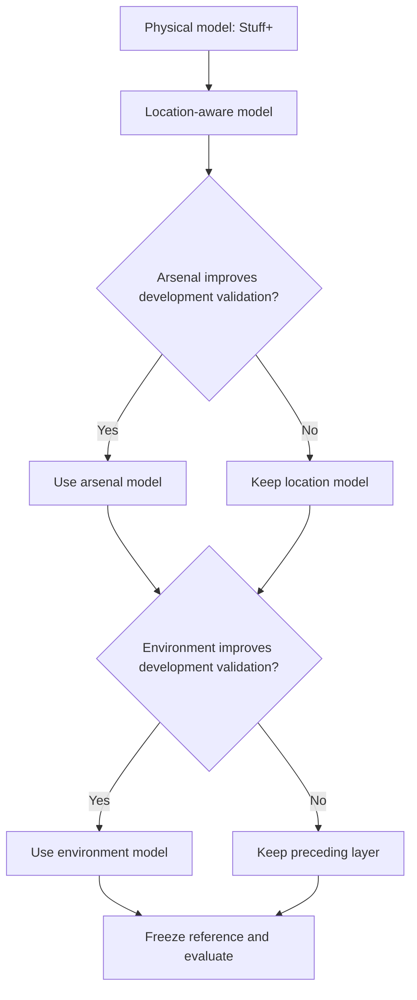

# Understanding the Diablos Stuff+ project

Start the app with `.venv/bin/python -m streamlit run app.py` and open **Entender el proyecto**. For the full Spanish explanation, read [GUIA_PROYECTO.md](GUIA_PROYECTO.md). The [eight-page technical document](../../reports/v9/DOCUMENTO_TECNICO_V9.pdf) describes the original v9 experiment; this file documents the subsequent incremental validation improvement.

## What problem are we solving?

We estimate the expected quality of a baseball pitch from its measured properties. An individual hit or strikeout is noisy: a good pitch can have a bad outcome. Learning across many pitches helps compare physical profiles, placement and repertoires.

Three scores answer different questions:

| Score | Question | Inputs |
|---|---|---|
| Stuff+ | How good are the physical properties? | Velocity, movement, spin, release, extension, pitch type and throwing hand |
| Location+ | What does placement and count add? | Difference between physical and location-aware expected run value |
| Pitching+ | What quality is expected with the available context? | Physical properties, location, historical arsenal and altitude category |

Higher scores favor the pitcher. Each index uses `100 + 10 × z` with its own frozen calibration reference. **110 means one standard deviation above the reference, not 10% more outs.** The scores cannot be added together. A constant model is displayed as 100 and cannot rank pitches. This historical reference does not establish a separate league average for every stadium and season.

## Requirements and constraints from the supplied HTML

The source is the local `2026 ISAC Hackathon - Diablos Rojos_ Stuff Plus Model, Calidad de Pitcheo Ajustada por Entorno.html`, not a refreshed event website. It gives the project deadline as October 22, 2026. Teams must have 2–4 undergraduate or master's students. Submission goes to `itamsportsanalytics@gmail.com` with all teammates' email addresses. Nothing has been submitted automatically.

The four judging categories each carry 25%: model quality, out-of-sample robustness, arsenal/altitude integration, and practical usefulness. The required outputs are:

| Deliverable | Available implementation | Remaining limitation |
|---|---|---|
| Pitch, pitcher and arsenal scores | Training exports pitch parquet, `pitchers.csv` and `arsenal.csv` | Anonymous IDs; rankings describe the observed sample |
| Ideal physical profile for Diablos | Training profile medians, simulation, physical SHAP explanations | No validated Harp Helú-specific optimum |
| Operational recommendations | [Measured v9 recommendations](../../reports/v9/RECOMENDACIONES_V9.md) | Descriptive scouting cases, not causal prescriptions |
| Simulator and movement map | Streamlit app with scenarios, HB–IVB chart and model evidence | Compares altitude categories, not identified stadiums |
| Technical document, 6–10 pages | [Generated eight-page PDF](../../reports/v9/DOCUMENTO_TECNICO_V9.pdf) | Original v9 evidence; read this supplement for the new gate |
| Season, pitcher and park validation | Existing season/pitcher/altitude experiments; `--holdout` CLI | Park validation requires an official stadium mapping; new incremental run is season-only |

The HTML restricts the supplied data to the competition, permits presenting results but not the original dataset, excludes betting use, and mentions an NDA for finalists. Keep the original data and individual prediction artifacts local. This repository's older tracked artifacts should be reviewed before any public release; `.gitignore` does not remove previously tracked files.

## Data and targets

The full parquet is discovered at `Data/stuff_model_df.parquet`. Small Git LFS pointers in the repository root are not usable data. There are 499,398 development pitches from 2024–2025 and 135,604 evaluation pitches from 2026.

Outcomes and exit velocity construct training labels; they are not prediction inputs. IDs are used for grouping and historical profiles, not learned as predictive features. The run-value target is a weighted outcome **proxy**, not a reconstructed base-out run expectancy model. Whiff means swing-and-miss according to the dataset, despite the HTML's ambiguous foul-or-miss wording.

Probabilities have different denominators. Whiff per pitch differs from whiff given a swing; groundball is conditional on eligible balls in play; weak/hard contact is conditional on measured contact. They are separate models and should not be summed as a joint outcome distribution. We do not claim to estimate outs within a plate appearance without the necessary PA data.

## How the ML pipeline works

1. Validate required columns, unique pitch IDs, years and legal counts.
2. Reserve the evaluation season. Within each earlier season, assign whole games to fit (50%), early stopping (15%), calibration (15%), candidate selection (10%) and confirmation (10%). These within-season assignments are randomized, not chronological.
3. Build arsenal features from fit games in strictly earlier seasons. Shrink sparse fastball profiles toward type/hand peers and expose missing history explicitly.
4. Fit CatBoost trees. Run-value regressors learn residuals around a constant physical baseline or a smoothed count baseline. Classifiers optimize log loss. Early stopping controls tree count.
5. Fit shrinkage and, where supported, sigmoid probability calibration on calibration games. Choose a candidate on selection games. Require positive confirmation gain, a positive lower bootstrap bound, acceptable results across development years, and noninferior log loss for classifiers.
6. Freeze model selection and index scales before reading 2026. Save model hashes, dataset/code hashes, protocol, audit predictions and the inference bundle.
7. Evaluate MSE/RMSE or Brier/log loss and paired gains using whole-game resampling. Report results even when a model fails to improve.

The physical feature boundary remains strict. Changing location, count, altitude or pitcher history cannot change physical Stuff+. Inference uses the same saved models and preprocessing as the simulator and needs no observed outcomes.

## The new improvement: require each contextual layer to earn its place

Previously, all four regression layers only needed to beat their simple baseline. Arsenal and environment could pass that test while performing worse than the location model. The original 2026 RMSEs illustrate this: location **0.213384**, arsenal **0.213449**, environment **0.213457**.

With `--incremental-gate`, the arsenal model competes against the selected location model, and the environment model competes against the selected arsenal layer. Selection and confirmation use only development data. If the additional layer fails, inference inherits the preceding layer's predictions. Fitted models remain saved for audit. The original run is preserved.



This is conservative model selection, not a guarantee that future error cannot increase. The layers share development partitions, so the bootstrap bounds are selection diagnostics, not independent post-selection confidence guarantees. A new untouched season is still needed. The gate was motivated by an already inspected benchmark; 2026 remains a reused benchmark, even though its labels are not used by the training procedure.

If the environment layer inherits its parent, the combined run-value altitude delta is exactly zero for otherwise identical inputs. That means additional predictive value was not confirmed. It does **not** mean altitude has no physical effect. The separate contextual probability models can still vary with altitude; the new gate applies only to the arsenal and environment run-value layers.

The completed 300-iteration experiment rejected both additional run-value layers on development data. Across the same 135,604 evaluation pitches, combined RMSE decreased from **0.213457 to 0.213384**: a modest **0.068% reduction in MSE**, with a paired game-bootstrap interval of **0.039%–0.104%** on this reused benchmark. Physical and location predictions were unchanged. This improves selection discipline; it does not establish an altitude effect or satisfy the missing park validation.

## Reproduce and inspect

```bash
python -m venv .venv
source .venv/bin/activate
python -m pip install -r requirements/requirements-entrega.txt
python -m unittest test_stuff_plus_v9 test_dashboard_stuff_plus_v9 -v
python src/entrenar_stuff_plus_v9.py --incremental-gate --iteraciones 300 --hilos 3 --salida stuff_plus_output_v9_incremental
python -m streamlit run app.py
```

On Windows activate `.venv\Scripts\Activate.ps1`. Training refuses to overwrite an existing experiment; use a fresh `--salida` directory for a new run. The app offers the original and incremental runs when their artifacts are present. In the evidence tab, inspect which model was selected and what it competed against. A zero gain in an inherited layer is an intentional fallback.

Original v9 reports can be regenerated with `python src/reportar_v9.py` followed by `python src/generar_documento_v9.py`. The PDF contains original v9 results, not results from the incremental run. Tests cover grouped splits, leakage boundaries, calibration, persistence, outcome-free inference, batch invariance, parent fallbacks, SHAP reconstruction and dashboard interaction.

After both evaluations complete, run `python src/comparar_incremental_v9.py` for the [measured original-versus-incremental comparison](../../reports/v9_incremental/README.md). It verifies matching dataset hashes, years, training budgets and pitch IDs before comparing run-value predictions. The comparison exports aggregate metrics rather than individual pitches.

## How to use this with a coach

Choose a pitch type and throwing hand, start from a measured profile, then enter the pitch's actual velocity and movement. Read Stuff+ first, then placement and combined quality. Inspect training-range warnings and whether arsenal history exists. Compare the altitude scenarios while holding measurements fixed, and review the selected model's evidence before making a claim about an environment effect.

Use rankings to identify video-review candidates. Check pitch and game counts, role and context. The simulator does not transport pitch movement through air of a different density, optimize a causal training intervention, identify Harp Helú, or establish a player's true talent. Obtaining official stadium identifiers and a fresh evaluation season is the most consequential next step for meeting the remaining requirements honestly.
