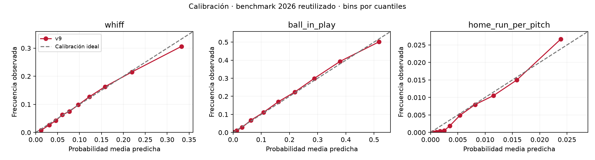

# Evidencia del experimento v9

135,604 pitches de evaluación; 13/13 tareas superaron el criterio de selección antes de evaluar 2026.
2026 es un benchmark reutilizado. Las comparaciones siguientes usan el mismo target de carreras y exactamente los mismos pitches. Cambian definición física, features, muestra de ajuste y selección: es una comparación de pipelines, no una ablación aislada de algoritmo.

| Modelo | RMSE v8 | RMSE v9 | Reducción MSE | IC 95% reducción |
|---|---:|---:|---:|---:|
| stuff_run_value | 0.217639 | 0.217595 | 0.04% | [0.01%, 0.07%] |
| xrunvalue | 0.213155 | 0.213384 | -0.22% | [-0.26%, -0.17%] |
| environment_run_value | 0.213082 | 0.213457 | -0.35% | [-0.40%, -0.31%] |

Las predicciones de carreras v8 se reconstruyen invirtiendo su referencia guardada, y se verifican contra los tres RMSE archivados antes de comparar. Un valor negativo indica deterioro y se conserva en el informe.

- [Métricas temporales completas](RESULTADOS.md)
- [Comparación de carreras en CSV](comparacion_carreras_v8_v9.csv)
- [Auditorías de pitchers y entorno](auditorias.csv)
- [Ablaciones de ubicación, arsenal y entorno](ablaciones.json)
- [Documento técnico de ocho páginas](DOCUMENTO_TECNICO_V9.pdf)
- [Verificación de inferencia](VERIFICACION.json)
- [Guía del proyecto y requisitos](../../docs/guias/GUIA_PROYECTO.md)

Las probabilidades v9 incorporan ubicación y contexto. No se presenta su cambio de AUC frente a las probabilidades físicas v8 como una mejora algorítmica aislada. El gráfico de calibración es descriptivo y no incluye intervalos.

Las auditorías de pitcher y entorno reentrenan los cuatro modelos de carreras. No certifican los nueve clasificadores contextuales. La auditoría de entorno excluye una categoría de altitud, no un parque identificado.
