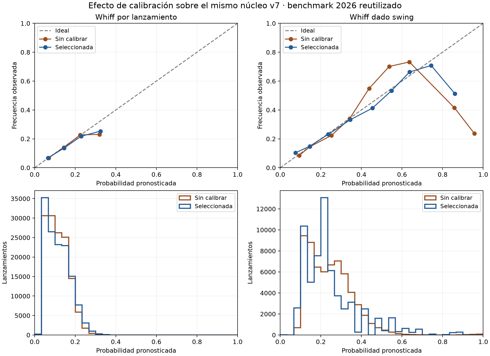

# Resultado de los experimentos v7

Se completaron **135,604 predicciones de 2026**, con calibración separada y un compuesto físico aprendido de predicciones fuera de muestra. V6 se conserva como referencia y respaldo.

**2026 ya se evaluó en v5 y v6.** Esta es una comparación reutilizada, no una confirmación independiente con datos nuevos. Los resultados de 2026 no eligen calibradores, pesos ni mezclas de este experimento.

## Separación de datos

| Función | Filas | Juegos por temporada, disjuntos entre funciones |
|---|---:|---:|
| fit | 299,031 | 1,002 |
| early_stop | 49,704 | 166 |
| calibration | 74,996 | 249 |
| selection | 75,667 | 255 |

Los componentes se ajustan solo con `fit`; `early_stop` elige el número de árboles; `calibration` ajusta las curvas de probabilidad; `selection` elige calibrador, regularización y mezcla. Todos los juegos son anteriores a 2026. Los perfiles de arsenal usan covariables de temporadas anteriores, sin outcomes; la separación por juegos no pretende simular pitchers completamente desconocidos.

Tres bloques de juegos de `fit` generan una predicción OOF por fila. El modelo que la produce excluye su juego. Los calibradores de cada bloque se ajustan con sus predicciones sobre juegos de `calibration`, nunca con los outcomes de las filas OOF. El metamodelo solo aprende con estas predicciones y targets de `fit`.

## Calibración seleccionada antes de 2026

| Tarea | Método seleccionado | Brier sin calibrar en selección | Brier seleccionado | ECE sin calibrar | ECE seleccionada |
|---|---|---:|---:|---:|---:|
| whiff | sigmoid | 0.098772 | 0.098730 | 0.004149 | 0.000673 |
| whiff_given_swing | isotonic | 0.169524 | 0.168086 | 0.022198 | 0.007379 |

Para cambiar se exige menor ECE de bins uniformes, control de ECE con bins por cuantiles y no inferioridad de Brier/log loss dentro de tolerancias prefijadas. Si nadie cumple, se mantiene identidad. La calibración isotónica puede introducir empates y cambiar AUC; no se promete que cualquier calibrador mejore todas las métricas.

## Efecto de calibrar el mismo núcleo v7 en 2026

| Tarea | AUC bruto → calibrado | Brier bruto → calibrado | ECE bruto → calibrado | Reducción Brier e IC 95% por juego |
|---|---|---|---|---|
| whiff | 0.6443 → 0.6443 | 0.097224 → 0.097279 | 0.002683 → 0.006169 | -0.06% [-0.10%, -0.02%] |
| whiff_given_swing | 0.6757 → 0.6752 | 0.170656 → 0.169068 | 0.021742 → 0.012782 | 0.93% [0.67%, 1.19%] |

Las curvas muestran diez bins uniformes con al menos 30 observaciones; las métricas incluyen todas las filas elegibles. Los histogramas permiten ver dónde hay muestra. Estas curvas son de evaluación y no se utilizan para reajustar los modelos.

## Comparación total frente a v6

| Tarea | Métrica | v6 | v7 | Reducción MSE/Brier e IC 95% por juego |
|---|---|---:|---:|---|
| whiff | AUC | 0.65079 | 0.64429 | -0.36% [-0.47%, -0.27%] |
| whiff_given_swing | AUC | 0.68152 | 0.67516 | 0.37% [-0.02%, 0.84%] |
| ball_in_play | AUC | 0.54372 | 0.57550 | 0.59% [0.53%, 0.65%] |
| groundball_given_in_play | AUC | 0.62187 | 0.62300 | 0.07% [-0.10%, 0.25%] |
| home_run_per_pitch | AUC | 0.56697 | 0.57292 | -0.00% [-0.02%, 0.02%] |
| exit_speed_given_in_play | RMSE | 15.30304 | 15.29593 | 0.09% [-0.03%, 0.22%] |
| stuff_run_value | RMSE | 0.21764 | 0.21764 | 0.00% [0.00%, 0.00%] |

El núcleo v7 reserva juegos adicionales para calibración y selección: usa aproximadamente 60% de los juegos anteriores para ajustar sus componentes; v6 usó aproximadamente 80% para sus modelos. Cambian datos de ajuste y arquitecturas, además de calibración. Por ello el efecto aislado de calibrar es la tabla anterior, no la diferencia total con v6. El componente de HR v7 es físico y excluye altitud; en v6 el predictor de HR la incluía. Las demás salidas contextuales siguen en v6.

## Compuesto aprendido

**Sustitución seleccionada: no; se conservan los índices del padre.** Se comparan tres valores de regularización y mezclas prefijadas con un control físico directo. La mejor opción en selección usa alpha=10, componentes sin calibrar y peso candidato=1.00; su reducción MSE en selección fue 0.06%. El peso de despliegue es 0.00.

El control directo se entrena con los mismos juegos de ajuste y parada que los componentes. Comparar contra él ayuda a separar el efecto del compuesto del cambio de muestra respecto a v6.

En 2026, RMSE del control común: **0.217641**; candidato: **0.217570**. Reducción MSE frente al control: **0.06%**, IC 95% **[0.03%, 0.09%]**.

Los pesos se ajustan mediante ridge con restricciones de signo: whiff/rodado favorables y HR/velocidad de salida desfavorables, manteniendo otras predicciones fijas. Son supuestos de regularización, no efectos causales. Los coeficientes se exportan en `pesos_compuesto.csv`. Los productos P(BIP)·P(GB|BIP) y P(BIP)·EV condicional evitan tratar una probabilidad condicional como si fuera una tasa por pitch.

Cuando se selecciona el compuesto, Stuff+ y Location+ usan una referencia guardada de juegos de calibración anteriores a 2026. Pitching+ conserva el modelo contextual con entorno de v6. Si el compuesto no cumple el mínimo en selección, los tres índices permanecen en el padre. Sin mediciones físicas adicionales, todas las predicciones públicas e índices conservan exactamente el respaldo v6/v5.

## Límites

Los intervalos usan 1,000 remuestreos pareados de juegos y son condicionales a estos modelos; no incluyen incertidumbre de entrenamiento ni corrigen la reutilización de 2026. Si cruzan cero, la mejora no es concluyente bajo este procedimiento. El target de carreras sigue siendo un proxy de pesos fijos, no RE24. El ranking usa regularización descriptiva e intervalos de variación de scores, no de talento real.

## Reproducir y auditar

`README_MODELO_V7.md` describe las fases. `verificar_modelo_v7.py` comprueba hashes, particiones, exclusión del propio juego, predicciones OOF y calibradas, pesos, selección e inferencia. Los resultados están en `verificacion.json` cuando esa auditoría ha terminado.
