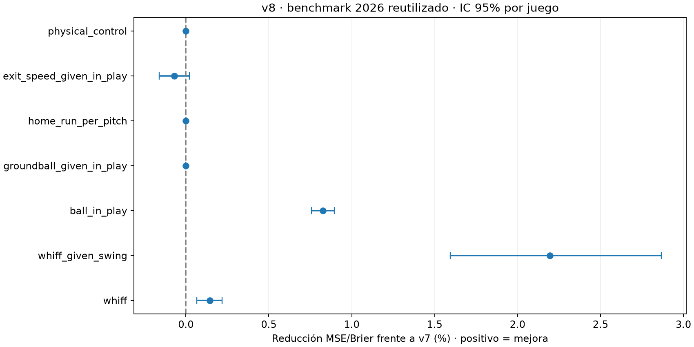

# Resultados v8

Se generaron 135,604 predicciones. **2026 es un benchmark reutilizado**, no una prueba independiente. Las decisiones se congelaron antes de leerlo en esta ejecución.

## Comparación controlada

Cada alternativa global usa los mismos juegos de ajuste y parada, semilla, arquitectura y presupuesto que su control v7. Se añaden ZoneSpeed, SpeedDrop y ZoneTime como bloque; este experimento no identifica el aporte individual de cada variable. Los especialistas usan el subconjunto de esos juegos correspondiente a su familia y se mezclan con el global (25%, 50% o 75%). Los tipos desconocidos usan el global.

El control de carreras usa las variables base v5, igual que el control directo v7. Los demás usan la física v6. El target sigue siendo un proxy de carreras, no RE24. No se entrenó un nuevo compuesto ni un objetivo esperado de contacto en esta versión.

## Selección anterior a 2026

La partición v7 se conserva: ajuste, parada, calibración y selección por juegos. Selección se divide en búsqueda y comprobación con juegos disjuntos. Se elige una sola alternativa en búsqueda y se exige al menos 0.1% de ganancia MSE/Brier en ambas mitades, sin deterioro superior a 0.1% en ninguna temporada de comprobación. Para clasificación se controla también log loss. Si falla, no se prueba la segunda mejor alternativa.

**Las mitades reutilizan datos de desarrollo de v7**: no son un holdout históricamente intacto. Tampoco representan validación mensual; el archivo solo contiene año. Sigmoide se ajusta exclusivamente en calibración. El control crudo permite comparar el núcleo en igualdad de condiciones; el resultado desplegado se compara abajo con la salida completa de v7, incluida su calibración. Estas comparaciones no son equivalentes.

| Tarea | Mejor candidato | Ganancia búsqueda | Ganancia comprobación | Activado |
|---|---|---:|---:|---|
| whiff | family_0.5 / sigmoid | 0.266% | 0.419% | Sí |
| whiff_given_swing | family_0.75 / sigmoid | 2.946% | 3.460% | Sí |
| ball_in_play | family_0.75 / raw | 0.846% | 0.846% | Sí |
| groundball_given_in_play | control | 0.000% | 0.000% | No |
| home_run_per_pitch | velocity / raw | 0.005% | 0.019% | No |
| exit_speed_given_in_play | velocity / raw | 0.118% | 0.171% | Sí |
| physical_control | velocity / raw | 0.010% | 0.017% | No |

## Aporte del bloque de velocidad sin calibración

Reducción frente al control crudo con igual muestra. La comparación identifica el efecto conjunto de las tres variables, sin atribuir efectos individuales.

| Tarea | Búsqueda | Comprobación |
|---|---:|---:|
| whiff | 0.123% | 0.207% |
| whiff_given_swing | 0.887% | 1.224% |
| ball_in_play | 0.283% | 0.273% |
| groundball_given_in_play | -0.030% | 0.058% |
| home_run_per_pitch | 0.005% | 0.019% |
| exit_speed_given_in_play | 0.118% | 0.171% |
| physical_control | 0.010% | 0.017% |

## Comparación desplegada v7 → v8 en 2026

| Tarea | Métrica | v7 | v8 | Reducción MSE/Brier [IC 95%] |
|---|---|---:|---:|---|
| whiff | brier | 0.097279 | 0.097139 | 0.144% [0.066%, 0.218%] |
| whiff_given_swing | brier | 0.169068 | 0.165359 | 2.194% [1.593%, 2.866%] |
| ball_in_play | brier | 0.146656 | 0.145445 | 0.825% [0.759%, 0.896%] |
| groundball_given_in_play | brier | 0.237707 | 0.237707 | 0.000% [0.000%, 0.000%] |
| home_run_per_pitch | brier | 0.006751 | 0.006751 | 0.000% [0.000%, 0.000%] |
| exit_speed_given_in_play | rmse | 15.295926 | 15.301194 | -0.069% [-0.162%, 0.021%] |
| physical_control | rmse | 0.217639 | 0.217639 | 0.000% [0.000%, 0.000%] |

| Tarea de clasificación | AUC v7 | AUC v8 | ECE v7 | ECE v8 |
|---|---:|---:|---:|---:|
| whiff | 0.64429 | 0.64985 | 0.006169 | 0.005471 |
| whiff_given_swing | 0.67516 | 0.69366 | 0.012782 | 0.021505 |
| ball_in_play | 0.57550 | 0.60622 | 0.007973 | 0.013189 |
| groundball_given_in_play | 0.62300 | 0.62300 | 0.011632 | 0.011632 |
| home_run_per_pitch | 0.57292 | 0.57292 | 0.000829 | 0.000829 |

Los intervalos usan 1,000 remuestreos pareados de juegos; no incorporan incertidumbre de entrenamiento ni eliminan el sesgo de reutilizar 2026. Las métricas completas (incluidos AUC, ECE y R²) están en metricas.json. Una ganancia en Brier no implica mejora en todas las métricas.

## Inferencia y límites

Cada tarea rechazada conserva exactamente la salida v7. Si faltan mediciones nuevas finitas o las mediciones físicas necesarias, la fila usa el respaldo v7. Pitching+ se conserva; Stuff+/Location+ solo cambian si se acepta el control directo de carreras, con una referencia fija de calibración. No mezclar referencias diferentes sin identificarlas.

Los especialistas se probaron para whiff, whiff dado swing y bola en juego. EV, rodados, HR y carreras recibieron la alternativa global de velocidad. La especialización ya compite con un global que conoce AutoPitchType; no se asume que segmentar mejore. El cambio de velocidades puede reflejar también medición o entorno; no se atribuyen efectos causales.

Para confirmar generalización temporal hacen falta fechas y datos futuros reservados; para RE24 hacen falta estados base-out y secuencia verificable. No se inventan esos datos. Ver README_MODELO_V8.md y verificacion.json para reproducir y auditar.
